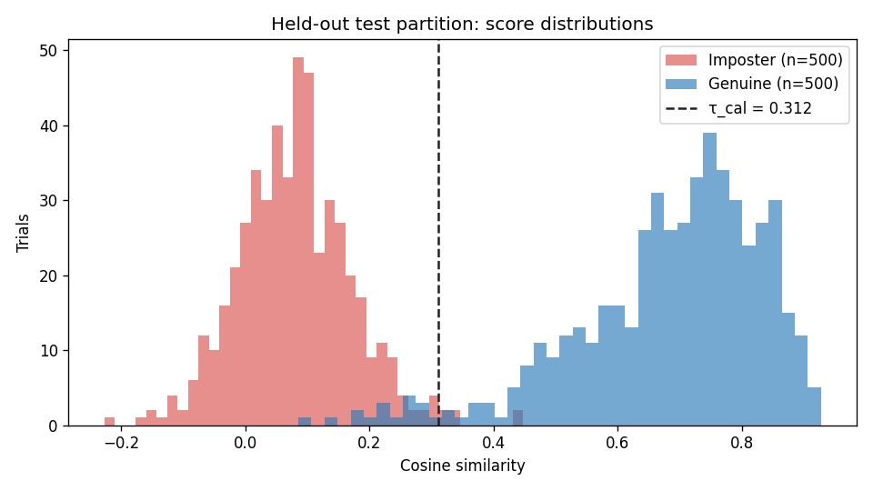
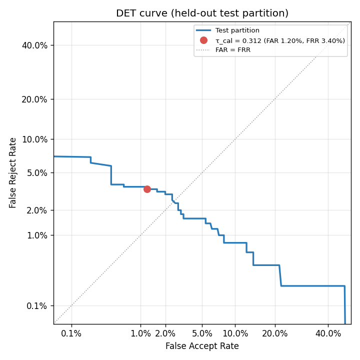

# VoxKey

[](https://github.com/ishanp-exe/Voice-Verification/actions/workflows/tests.yml)

## 1. Project Overview & Objectives

VoxKey is an educational voice-verification prototype demonstrating 1:1 biometric speaker verification in a simulated banking environment. It compares a candidate audio recording with an enrolled speaker profile to determine whether the two utterances may originate from the same speaker.

### Key Objectives:
- **Modular 1:1 Verification Engine**: Extract fixed-dimensional speaker embeddings using SpeechBrain's pretrained ECAPA-TDNN architecture and compare them via cosine similarity.
- **Modern Dark Analytics UI in Streamlit**: Polished, high-contrast, dark-mode analytics application built with Streamlit and styled with modern cards, hero spotlight, subtle scroll progress, and glassmorphic stats.
- **Native Browser Microphone Recording & Upload**: In-browser audio capture via Streamlit's native audio input (`st.audio_input`) and file upload (`st.file_uploader`) supporting `.wav`, `.flac`, `.mp3`, and `.ogg`.
- **Multi-Sample Volunteer Enrollment**: Combine multiple takes via element-wise arithmetic mean and unit $L_2$-normalization into a single robust template without retaining raw audio.
- **Volunteer Demo Mode**: Enable safe, consent-driven voice enrollment and verification with full local data privacy and instant data purging controls.
- **LibriSpeech Evaluation Mode**: In-situ benchmarking on external LibriSpeech audio, with a disciplined calibration vs. independent test split protocol, in-memory embedding caching for repeated trials, and empirical False Accept Rate (FAR), False Reject Rate (FRR), accuracy, and threshold trade-offs.
- **Modular Dataset Architecture**: Decouple dataset loading through an abstract adapter interface (`BaseSpeakerDatasetAdapter`) so domain-specific evaluation datasets can be integrated seamlessly once available.

---

## 2. Architecture & File Structure

```text
Voice-Verification/
├── .gitignore                   # Strict exclusion of data, recordings, embeddings, caches, venv
├── requirements.txt             # Dependencies (PyTorch, Torchaudio, SpeechBrain, Streamlit, optional FastAPI)
├── pyproject.toml               # Modern build configuration and package metadata
├── start.bat                    # Windows 1-click launcher (starts Streamlit & opens browser)
├── start.ps1                    # PowerShell 1-click launcher
├── app.py                       # Main Streamlit user interface (modern dark styling & full workflow)
├── README.md                    # Project documentation and run guide
├── docs/
│   ├── PROJECT_SYNOPSIS.md      # Formal internship project synopsis
│   └── results/                 # Benchmark outputs (results.json, trials.csv, charts)
├── scripts/
│   ├── clean_validate_dataset.py # Repeatable LibriSpeech validation & cleaning audit tool
│   ├── run_benchmark.py         # Headless calibration/test benchmark → docs/results/
│   └── run_dataset_eda.py       # Exploratory data analysis & distribution chart generator
├── data/
│   └── evaluation/              # Generated audit logs (audio_file_validation.csv, valid_audio_index.csv)
├── src/
│   ├── __init__.py
│   ├── audio.py                 # Audio ingestion, validation (format/length), 16 kHz mono conversion
│   ├── model.py                 # Pretrained ECAPA-TDNN model wrapper (frozen weights)
│   ├── verification.py          # Cosine similarity computation & multi-sample vector combining
│   ├── storage.py               # Local volunteer profiles, metadata, and deletion routines
│   ├── dataset_eval.py          # External LibriSpeech adapter & trial pair generator
│   ├── metrics.py               # Empirical FAR, FRR, and EER calculations
│   └── server.py                # Optional FastAPI backend app & static file endpoints
└── tests/
    ├── test_streamlit_app.py    # Streamlit AppTest integration test for app.py
    ├── test_api.py              # Backend REST endpoint tests using TestClient
    ├── test_benchmark.py        # Benchmark calibration, artifact, and privacy tests
    └── test_components.py       # Core audio, verification, storage, and metrics unit tests
```

---

## 3. Setup & Installation

> [!IMPORTANT]
> **First-Run Notice & Biometric Privacy**:
> - **Pretrained Model Download**: On the very first run, VoxKey automatically downloads SpeechBrain's pretrained ECAPA-TDNN model (`speechbrain/spkrec-ecapa-voxceleb`) from Hugging Face Hub. This requires an active internet connection and may take several minutes depending on network bandwidth.
> - **Local Model Cache**: Downloaded weights and hyperparameters are cached locally inside the repository directory at `speechbrain_cache/spkrec-ecapa-voxceleb/`. All subsequent runs reuse this downloaded copy and operate completely offline.
> - **Strictly Local Processing**: All voice audio recordings, extracted 192-dimensional embeddings, and volunteer profiles remain on your local computer. No audio or biometric data is ever transmitted to the cloud.

### Prerequisites
- **Python Version**: Python 3.10 is recommended (Python >= 3.10 supported) for reliable prebuilt PyTorch and SpeechBrain wheel compatibility.
- **Git**: Installed and available in your system path.
- **System Audio Dependencies (Linux / macOS)**:
  VoxKey uses `soundfile` (`src/audio.py`) to read and decode audio files (`.wav`, `.flac`, `.mp3`, and `.ogg`). While Windows and macOS wheels bundle standard libraries, some minimal Linux systems may need `libsndfile`; `ffmpeg` is not required (the code only uses `soundfile`):
  - **Ubuntu / Debian**:
    ```bash
    sudo apt-get update && sudo apt-get install -y libsndfile1
    ```
  - **Fedora / RHEL**:
    ```bash
    sudo dnf install libsndfile
    ```
  - **macOS (Homebrew, if needed)**:
    ```bash
    brew install libsndfile
    ```

---

### Quick Start on Windows

#### 1. Initial Environment Setup (First time only)
Double-click `setup.bat` in the project root (or run `.\setup.bat` in PowerShell). This script:
- Verifies Python 3.10 is installed on the system.
- Checks and creates `.venv` (preserving any existing environment without destructive deletion).
- Automatically installs and upgrades dependencies from `requirements.txt` and `pyproject.toml`.

#### 2. Verify your setup
Run the environment verification script to validate that your Python version, virtual environment, and dependencies are ready:
```powershell
.\.venv\Scripts\python scripts/check_setup.py
```
This uses the project's `.venv` Python, so activating the venv first is not needed.

#### 3. Launch the Application
Double-click `start.bat` in the project root, or execute from PowerShell:
```powershell
.\start.bat
```
Alternatively, for PowerShell:
```powershell
.\start.ps1
```

This launcher:
1. Validates the `.venv` Python virtual environment.
2. Automatically launches your default web browser to `http://127.0.0.1:8501`.
3. Runs the local Streamlit application.

---

### Setup on macOS / Linux

Follow these steps to set up and run VoxKey on macOS or Linux:

#### 1. Clone the repository
```bash
git clone https://github.com/ishanp-exe/Voice-Verification.git
cd Voice-Verification
```

#### 2. Create and activate a virtual environment
```bash
python3 -m venv .venv
source .venv/bin/activate
```
*(Ensure `python3` points to Python 3.10 or newer. On systems with multiple Python versions, specify `python3.10 -m venv .venv`).*

#### 3. Install dependencies
```bash
pip install --upgrade pip
pip install -r requirements.txt
pip install -e .
```

#### 4. Verify your setup
Run the environment verification script to validate that your Python version, virtual environment, required dependencies, and directory permissions are ready:
```bash
python scripts/check_setup.py
```
*(This script runs using only the Python standard library and does NOT download the speaker model. All checks should report `[PASS]`).*

#### 5. Launch the Streamlit application
Start the Streamlit application using the same host and port configuration as the Windows launcher:
```bash
streamlit run app.py --server.address 127.0.0.1 --server.port 8501
```
Open your web browser and navigate to `http://127.0.0.1:8501`.

#### 6. (Optional) Launch the FastAPI backend
If you wish to run the standalone REST API backend (`src/server.py`):
```bash
uvicorn src.server:app --host 127.0.0.1 --port 8000
```
Interactive API documentation will be available at `http://127.0.0.1:8000/docs`.

#### 7. Run automated tests
Run the full test suite in your virtual environment:
```bash
pytest -v
```

---

### Command Quick Reference

The table below maps each Windows setup and execution command to its macOS / Linux counterpart:

| Task / Action | Windows (PowerShell / CMD) | macOS / Linux (Bash / Zsh) |
| :--- | :--- | :--- |
| **Create venv** | `py -3.10 -m venv .venv` | `python3 -m venv .venv` |
| **Activate venv** | `.\.venv\Scripts\Activate.ps1` (or `Activate.bat`) | `source .venv/bin/activate` |
| **Install requirements** | `pip install -r requirements.txt` | `pip install -r requirements.txt` |
| **Install package (editable)** | `pip install -e .` | `pip install -e .` |
| **Verify setup** | `.\.venv\Scripts\python scripts/check_setup.py` | `python scripts/check_setup.py` |
| **Start Streamlit app** | `.\start.bat` or `.\start.ps1` | `streamlit run app.py --server.address 127.0.0.1 --server.port 8501` |
| **Start FastAPI server (optional)** | `uvicorn src.server:app --host 127.0.0.1 --port 8000` | `uvicorn src.server:app --host 127.0.0.1 --port 8000` |
| **Run tests** | `pytest -v` or `.\.venv\Scripts\pytest -v` | `pytest -v` |
| **Validate LibriSpeech** | `python scripts/clean_validate_dataset.py ...` | `python scripts/clean_validate_dataset.py ...` |

---

## 4. LibriSpeech Dataset Cleaning & Validation

Before benchmarking on external corpus audio, validate the dataset integrity without modifying, moving, or renaming any original files:

```powershell
# Type the path to your local LibriSpeech test-clean folder
.\.venv\Scripts\python scripts/clean_validate_dataset.py --dataset-dir "<path/to/LibriSpeech/test-clean>" --output-dir "data/evaluation"
```

This script:
- Decodes every audio file via `soundfile` to verify readability, channel count, and sample rate.
- Checks audio duration against the minimum threshold ($\ge 0.8$s).
- Computes SHA-256 hashes to reliably flag duplicate files.
- Checks directory vs. filename speaker labeling consistency.
- Generates 3 audit files outside the dataset directory in `data/evaluation/`:
  - `audio_file_validation.csv`: Comprehensive log of all audio files with status and rejection reasons.
  - `valid_audio_index.csv`: Curated index of files that passed all checks.
  - `dataset_cleaning_summary.txt`: Human-readable summary of files checked, valid/rejected counts, and speaker distributions.

### Dataset EDA (optional)

Once the validated index (`data/evaluation/valid_audio_index.csv`) is generated, you can run the exploratory data analysis script to compute dataset duration percentiles, speaker distribution tables, and summary charts in `data/evaluation/eda/`:

- **Windows (PowerShell)**:
  ```powershell
  .\.venv\Scripts\python scripts/run_dataset_eda.py
  ```
- **macOS / Linux**:
  ```bash
  python scripts/run_dataset_eda.py
  ```

---

## 5. Benchmark Results (LibriSpeech test-clean)

Measured with `scripts/run_benchmark.py` on the validated index (2,620 recordings, 40 speakers). Speakers are split into two disjoint halves: the threshold is chosen on the 20 **calibration** speakers only, then applied unchanged to the 20 held-out **test** speakers.

| Metric | Value |
| :--- | :--- |
| Calibrated threshold τ_cal (EER point on calibration speakers) | **0.3118** |
| Calibration EER | 1.40% |
| Test FAR at τ_cal | **1.20%** (6 / 500 imposter trials) |
| Test FRR at τ_cal | **3.40%** (17 / 500 genuine trials) |
| Test accuracy at τ_cal | **97.70%** |
| Test EER (reference only, not used to set τ) | 2.50% |
| Trials | 1,000 calibration + 1,000 test, 0 skipped |
| Seeds | split 42, calibration trials 42, test trials 100 |

<p>
  
  
</p>

The app's default threshold of 0.31 comes from this calibration. Full outputs are in [`docs/results/`](docs/results/): `results.json` (summary) and `trials.csv` (every scored trial).

> **Read these numbers carefully**: LibriSpeech is clean, read audiobook speech recorded at 16 kHz. Error rates on telephone, noisy, or spoofed audio will be higher, and 20 test speakers is a small sample.

Reproduce (about 7 minutes on CPU; the model must already be downloaded):
```bash
python scripts/run_benchmark.py --dataset-dir "<path/to/LibriSpeech/test-clean>"
```

---

## 6. Usage Guide

### Mode 1: Volunteer Demo Mode
1. **Informed Consent Gate**: Check the volunteer consent box. Without consent, recording and enrollment are blocked.
2. **Multi-Sample Enrollment**:
   - Record multiple separate takes via microphone or file upload ($\ge 1.0$s each).
   - Staged samples are combined via arithmetic mean and unit $L_2$-normalization into a single robust template vector. Raw audio is discarded immediately.
3. **1:1 Verification**:
   - Select the enrolled Demo ID from the dropdown.
   - Record or upload a single candidate audio sample.
   - Adjust the **Decision Threshold** slider (calibrated dev point: $\tau = 0.31$).
   - Click **Verify Candidate Voice** to view the similarity score, threshold, decision margin, and match/no-match verdict.
4. **Data Governance & Consent Withdrawal**:
   - Permanent profile purging and immediate consent withdrawal are available in **Profile Governance**.

### Mode 2: LibriSpeech Evaluation Mode
1. **Pre-Validated Index Active**: When `data/evaluation/valid_audio_index.csv` is present, the benchmark automatically draws trial pairs exclusively from verified clean files.
2. **Calibration & Test Split**:
   - **Calibration Partition (Dev)**: Operating threshold $\tau_{cal}$ is determined where empirical Equal Error Rate is reached.
   - **Held-Out Evaluation Partition (Test)**: Unbiased performance metrics (FAR, FRR, Accuracy) are measured on unseen evaluation speakers at the fixed $\tau_{cal}$.
3. **Export Benchmark Results**: Download full evaluation results with seeds, trial breakdowns, and confusion counts as JSON or CSV.
4. **Transparent Reporting**: Reports exact trial breakdown, calibration and evaluation seeds, cache statistics, and any unreadable/skipped files.

---

## 7. Privacy & Data Handling Practices
- **Strictly Local Processing**: Audio files and embeddings remain on the local machine. No data is transmitted to cloud services or external APIs.
- **Tightened Local API Access**: The optional FastAPI backend application is bound strictly to `127.0.0.1` and CORS is restricted to local application origins (`http://127.0.0.1:8000`, `http://localhost:8000`).
- **Minimal Retention**: By default, raw audio is discarded immediately following embedding extraction. Only mathematical embedding vectors and non-PII metadata (`metadata.json`) are stored.
- **Git Safety**: The `data/` directory, model cache, audio files, and virtual environments are explicitly excluded via `.gitignore` to prevent accidental commits of biometric data.
- **Instant Deletion**: Volunteers have full control to permanently remove their enrolled templates at any time.

---

## 8. Understanding Scores & Thresholds
- **Cosine Similarity is NOT a Probability**: Cosine similarity measures geometric alignment in $[-1.0, 1.0]$. A score of `0.65` does not represent a "65% chance of being the same person."
- **Configurable Decision Threshold**: Different security postures require different operating points. High thresholds minimize False Accepts (imposter breach), while low thresholds minimize False Rejects (customer friction). No threshold should be considered "typical" without empirical calibration on target channel audio.

---

## 9. Limitations & Scope Boundaries
- **Prototype Status**: Designed exclusively for internship-level education and research.
- **No Anti-Spoofing / Presentation Attack Detection (PAD)**: Vulnerable to replays, text-to-speech synthesis, and deepfakes.
- **No 1:N Identification**: Evaluates one-to-one identity claims only.
- **Domain Discrepancy**: Pretrained models trained on studio/audiobook audio may experience reduced performance on narrow-band (8 kHz) telephony audio.
- **Enterprise Dataset Roadmap**: Domain-specific banking datasets can be integrated via the modular `BaseSpeakerDatasetAdapter` interface.

---

## 10. Running Automated Tests

To run the automated unit and API test suite from the repository root in PowerShell:
```powershell
.\.venv\Scripts\pytest -v
```
All automated tests utilize mocked embedding outputs to verify code paths, multi-sample combining math, validation logic, metrics formulas, REST endpoints, and storage operations in test isolation without requiring GPU hardware or Internet access.
